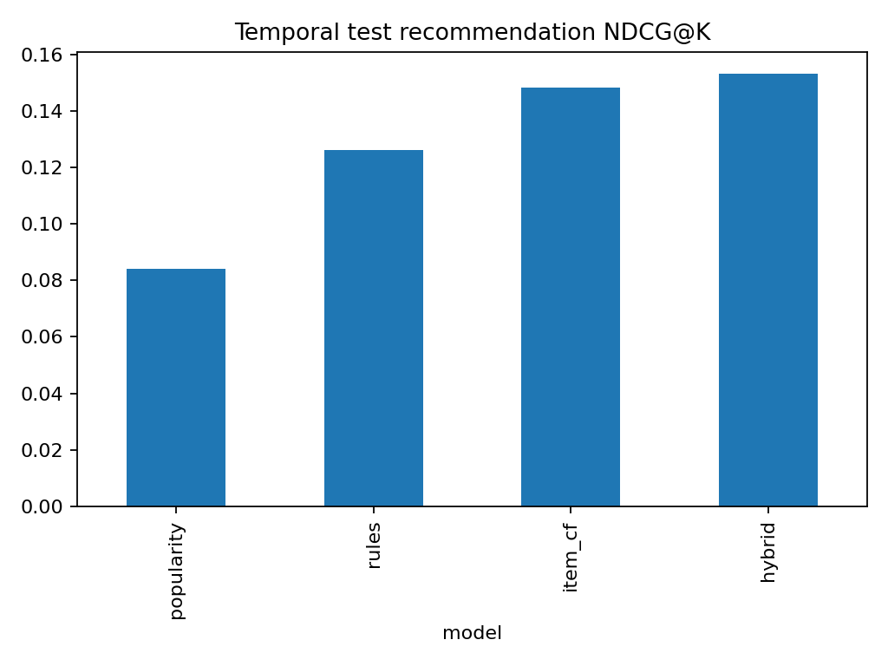
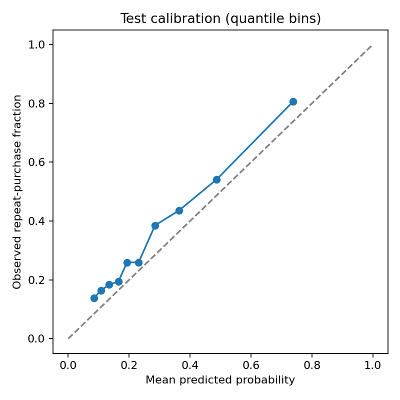
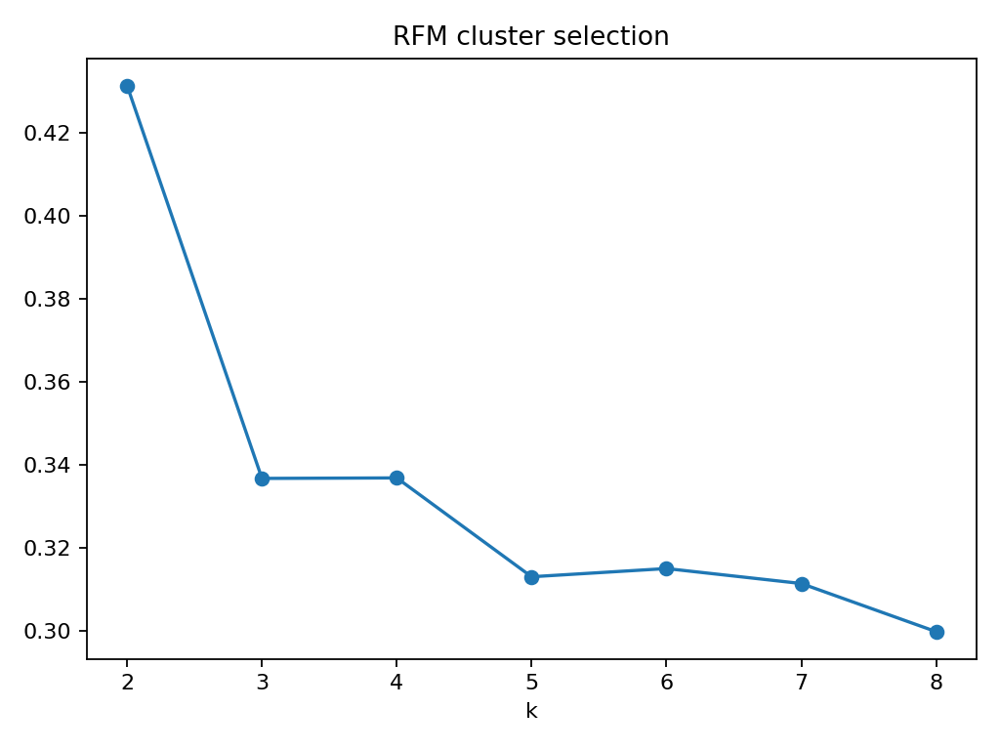

# Verified Colab run — 2026-11-05

These aggregate outputs and figures are copied unchanged from the uploaded Colab results archive. All 35 artifact hashes in the original manifest were checked and matched. The manifest describes the full original run; row-level outputs and model binaries listed in it are intentionally not included here. The source workbook is downloaded by the notebook, not committed.

The run completed in 153.84 seconds (pipeline only), using Python 3.13.18. The original run did not record a Git commit because it used the ZIP-based workflow. This repository was published after that run; do not retroactively attribute the experiment to a commit.

## Results

- 541,909 raw rows; 533,652 retained merchandise ledger rows; 391,150 modeling purchase rows; 4,334 modeled customers.
- K-Means selected K=2, silhouette 0.4312. The more frequent, higher-spending segment contains 1,660 customers and 84.9% of qualifying modeled-customer purchase value.
- 88 association rules and 250 frequent itemsets. Apriori: 0.354 seconds; FP-Growth: 5.659 seconds under identical restrictions. This single-run comparison is not a universal algorithm ranking.
- October recommendation NDCG@10: popularity 0.0841, rules 0.1261, item CF 0.1483, hybrid 0.1533. Hybrid alpha=0.75 was selected on September validation data. Test evaluation includes 1,361 purchasing customers.
- November repeat-purchase prediction: selected logistic model AP=0.6371, ROC-AUC=0.7373, Brier=0.1858. Prevalence baseline AP=0.3368, Brier=0.2288. The probabilities underpredict observed rates in all exported calibration bins.

The hybrid's NDCG improvement is 82.3% relative to popularity and 3.4% relative to item CF. These are offline ranking comparisons, not revenue uplift or proof of statistical significance. The hybrid does not win every metric. Prediction F1/precision/recall comparisons use a validation-selected threshold for the selected model and 0.5 for other models; AP, ROC-AUC and Brier provide threshold-independent comparisons.

## Figures

## Data attribution

Derived from Daqing Chen (2015), Online Retail, UCI Machine Learning Repository, https://doi.org/10.24432/C5BW33, CC BY 4.0. Cleaning and transformations are documented in ../../docs/DATA_CARD.md and ../../docs/METHODOLOGY.md.

The Power BI Desktop dashboard still needs to be assembled and validated. Follow ../../powerbi/BUILD_GUIDE.md using the full results ZIP retained from Colab.
